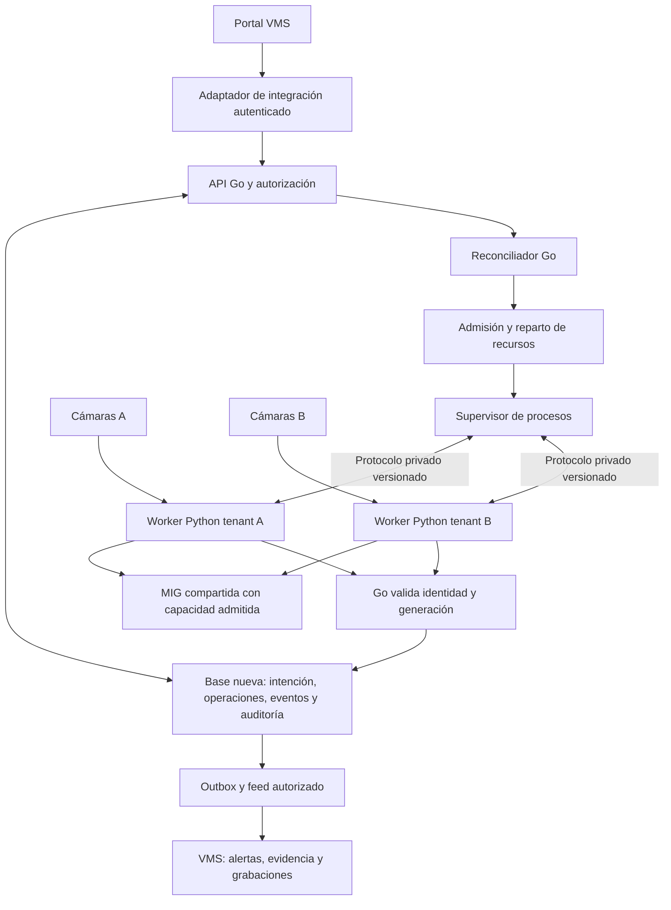
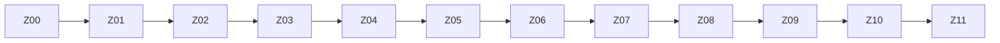

# Plan de construcción de Kinich desde cero con control en Go

- **Fecha:** 15 de octubre de 2026. Zona de operación: America/Mexico_City.
- **Versión:** 1.0. **Estado:** PLANIFICADO.
- **Alternativa a:** [plan de migración del motor existente](Kinich_Plan_Maestro_Migracion_Go_2026-10-15.md). Ambos planes son opciones de ejecución; sus horas no se suman.
- **Resultado:** un motor nuevo, con contratos, esquema de datos, supervisor y API diseñados desde el inicio para multitenancy, cámaras continuas y composiciones de modelos.
- **Tecnología base:** control Go y workers Python/CUDA con los pesos y la lógica de las analíticas existentes.
- **Estimación propia:** 320–520 horas de ingeniería, aproximadamente 8–13 semanas de una persona a 40 h/semana. Incluye documentación, validación e integración con VMS; excluye esperas por hardware/material y entrenamiento de modelos.
- **Punto de reestimación:** al cerrar Z01 y Z04, después de validar contrato y worker real. Los rangos son una estimación inicial, no resultados de un desarrollo ya ejecutado.

## 1. Qué significa construir desde cero

Se construye una nueva aplicación de control, sin portar los managers, handlers, esquema SQLite ni modos legacy de Kinich como base operativa. Se parte de un contrato nuevo y explícito; la integración con VMS se hace mediante un adaptador acotado. El motor anterior sirve como referencia de comportamiento y posible retorno operativo durante la transición.

Se reutilizan los activos que ya resuelven el problema de visión: pesos, lógica de inferencia, tracking, pre/postprocesamiento y reglas temporales de los modelos. Se adaptan a un contrato de worker limpio y se comprueban sus estados compartidos. Reutilizar un detector no autoriza a reutilizar sus globals, archivos comunes o dependencias de la API antigua.

**Construir el motor desde cero no significa entrenar 14 modelos nuevos.** La eliminación de Python y la creación de nuevas analíticas se distinguen en la sección 12 para no ocultarlas dentro del presupuesto base.

### 1.1 Diferencias frente al plan de migración

| Tema | Migración del motor existente | Construcción desde cero de este plan |
|---|---|---|
| Base de implementación | Portar y reutilizar módulos de control probados | Implementación nueva de control, persistencia y runtime de servicio |
| Contrato externo | Mantener la superficie de consumidores actuales durante el cambio | API nueva; un adaptador VMS cubre el consumidor identificado |
| Datos operativos | Migrar esquema, historial e intención actuales | Base nueva; importar sólo datos aprobados con mapeo explícito |
| Autenticación | Resolver transición de modos legacy | Autenticación obligatoria desde el primer endpoint operativo |
| Identidad de cámara | Introducir identidad estable en el sistema existente | UUID de cámara y propiedad inmutables desde el alta |
| Pruebas | Reutilizar suite y ampliar cobertura | Construir la suite del nuevo contrato; usar clips y resultados previos como referencia |
| Riesgo dominante | Convivencia y compatibilidad de implementación/datos | Omitir comportamiento útil del sistema anterior y subestimar los adapters de modelos |
| Plazo inicial | 240–400 h | 320–520 h |

El ahorro de deuda y compatibilidad interna no convierte la construcción nueva en una tarea menor. Hay que demostrar de nuevo seguridad, recuperación, propiedad de procesos, entrega de eventos y capacidad real. Una maqueta que ejecuta un modelo es sólo el primer corte.

### 1.2 Alcance completo de la primera versión

1. Tenants, entornos, credenciales de servicio, scopes, cuotas y auditoría.
2. Catálogo versionado y configuración validada para las 14 analíticas actuales, `combo` y `pulso`.
3. Cámaras con identidad estable, fuentes protegidas, revisión, estado habilitado y configuración de geometría.
4. Ejecuciones continuas, desconexión persistente, cancelación, colas y horarios.
5. Workers Python supervisados por Go, identidad de proceso, generaciones y concesiones renovables.
6. Modelos agrupados por cámara, mutaciones de composición y estado independiente por miembro.
7. Admisión de recursos, perfiles de residentes, reparto entre tenants y límites de trabajo en vuelo.
8. Eventos durables, callbacks recuperables, historial, replay y overlay autorizado.
9. Predicciones de imagen/clip que respetan los mismos permisos y presupuestos que las cámaras.
10. Adaptador VMS, asociación correcta con alertas/grabaciones, métricas y operación documentada.
11. Pruebas de modelos, multitenancy, procesos, fallos, carga real y despliegue controlado.

### 1.3 Límites de esta primera versión

El producto a construir es el motor Kinich y su integración, no una nueva VMS ni una nueva interfaz de administración completa. Se aprovechan el portal y el sistema de medios existentes. Tampoco se incluyen entrenamiento, exportación obligatoria de todos los modelos, un broker nuevo, control distribuido con múltiples líderes ni aislamiento físico por tenant dentro de una MIG compartida.

La primera instalación usa un controlador Go activo y una GPU/MIG asignada. Una segunda réplica no se habilita como mecanismo de alta disponibilidad sin resolver propiedad y almacenamiento. La ampliación a varias GPUs se diseña después del perfil inicial, sin asumir que el rendimiento escala linealmente.

## 2. Requisitos e invariantes desde el primer día

### 2.1 Identidad y seguridad

- El alcance se deriva de una credencial autenticada. El cuerpo, `Host`, query o header libre del navegador no puede elegir otro tenant o entorno.
- Toda entidad y toda clave de caché, cola, cursor, entrega y archivo temporal conserva `environment` y `tenant_id`.
- Una cámara tiene UUID estable; la RTSP, la IP y el código visible no son identidad ni prueba de propiedad.
- Los mismos IDs visibles, URL RTSP y nombres de modelos en tenants diferentes no producen adopción ni cancelación cruzada.
- El navegador usa VMS/BFF; no recibe llaves del motor ni tokens de callback.
- Fuentes ajenas y recursos desconocidos devuelven no encontrado. Una credencial inválida recibe 401 y una válida sin scope suficiente, 403.
- Ningún modo anónimo o `legacy` se habilita en el motor nuevo para facilitar el despliegue. El adaptador se autentica y su alcance queda limitado.
- Las suscripciones y rutas de predicción se someten al mismo control que REST; no son vías alternativas sin permisos.

### 2.2 Propiedad y estado

- Go es la única autoridad del estado operativo y de las reservas. Los workers reportan lo observado; no escriben directamente la base del control.
- Cada sesión pertenece a una cámara, ejecución, miembro y generación. El proceso que la posee se conoce y puede localizarse sin buscar por nombre genérico.
- Retirar una generación impide aceptar sus resultados antes de comenzar la limpieza física.
- No se confirma una parada por haber enviado la orden, recibido HTTP 200 o perdido la conexión.
- Una ejecución de cámara registrada no tiene límite automático de tres minutos. Su tiempo máximo de espera en cola es una política diferente de su duración.
- Desconectar deshabilita la cámara hasta reactivación explícita, incluso después de reiniciar. Reactivar no resucita ejecuciones retiradas.
- Los pesos residentes pueden permanecer cargados después de cerrar una cámara. El cierre de una sesión no declara vacía toda la MIG.

### 2.3 Datos y resultados

- La disponibilidad de un modelo, la ejecución de una sesión y el resultado de una detección son conceptos distintos.
- `verificando` o `desconocido` no equivalen a cumplimiento ni a incumplimiento. En particular, EPP conserva sus transiciones y eventos específicos.
- Un evento conserva ID, propietario, modelo, miembro, generación y revisión. Un reintento HTTP no inventa otra identidad.
- La garantía durable comienza cuando Go confirma la persistencia del evento. El consumidor HTTP recibe al menos una vez y debe deduplicar.
- Replay, overlay y grabaciones no cambian de dueño al rotar la RTSP o reasignar una cámara.
- Un archivo incompleto se marca incompleto. No se declara un video listo mientras el escritor o su manifest siguen abiertos.

## 3. Arquitectura nueva y módulos

### 3.1 Esquema general

El controlador Go no mueve cada frame por IPC ni carga PyTorch. Python conserva captura, transformaciones, sesiones temporales y CUDA. La coordinación Go intercambia intención, políticas, estado y resultados acotados.

### 3.2 Procesos y aislamiento

La unidad inicial de worker es `(entorno, tenant, perfil de runtime compatible, MIG)`, con sesiones separadas por cámara y miembro. Los modelos sólo se cargan cuando hay demanda admitida; no precargar las 14 analíticas en todos los tenants.

Los pesos inmutables pueden compartirse dentro del mismo worker; trackers, buffers de frames, ROIs, votos de EPP, identidades y contadores nunca se comparten entre sesiones por accidente. Un global mutable de un plugin se elimina, se convierte en estado explícito o obliga a separar el perfil. Un prompt SAM incompatible no puede reemplazar silenciosamente el usado por otra cámara.

Go inicia los procesos hijos en grupos identificados y supervisa sus auxiliares. El empaquetado inicial los mantiene en un dominio donde pueda verificar su salida sin acceso administrativo al nodo. Reiniciar el controlador también debe retirar o invalidar sus hijos de manera comprobada.

Una extensión nativa bloqueada puede requerir matar el worker del tenant, afectando otras cámaras de ese mismo dominio. Las afectadas se declaran interrumpidas y sólo se reanudan las habilitadas. Si se exige que un fallo duro no interrumpa ninguna otra cámara, usar workers por cámara y repetir la capacidad por el costo extra de memoria. El aislamiento de datos no se presenta como una garantía de aislamiento físico de GPU.

### 3.3 Módulos del repositorio nuevo

El nombre de repositorio `kinich-go` es propuesto. Este plan no crea el repositorio ni copia código.

| Ubicación propuesta | Responsabilidad y límite |
|---|---|
| `cmd/kinichd` | Arranque y apagado, configuración validada y versión de release |
| `internal/api` | HTTP/OpenAPI, errores, operaciones asíncronas y canales autorizados |
| `internal/auth` | Principal, scopes, llaves, revocación y entorno |
| `internal/store` | Esquema nuevo, migraciones, transacciones y auditoría |
| `internal/reconcile` | Intención frente a estado observado; un propietario por ejecución |
| `internal/supervisor` | Procesos, comandos, leases, generaciones y cierre |
| `internal/admission` | Reservas de memoria, cuotas y límites de concurrencia |
| `internal/schedule` | Horarios y selección justa entre trabajos admitidos |
| `internal/events` | Persistencia, outbox, entrega, replay y retención |
| `internal/integrations/vms` | Traducción del contrato nuevo al consumidor VMS identificado |
| `proto/worker/v1` | Contrato privado Go/Python y código generado |
| `worker/` | Runtime Python nuevo y adaptadores de analíticas |
| `models/manifest` | Catálogo de versiones, esquemas y perfiles; no contiene pesos secretos |
| `tests/` | Contrato, aislamiento, fallos, integración y banco |
| `docs/` | Contratos y manuales versionados por módulo |

Usar la biblioteca estándar Go para HTTP, contexto, procesos, señales y sincronización. Elegir dependencias concretas sólo cuando cubran algo que la biblioteca estándar no aporta, como SQLite o el transporte Protobuf/gRPC. Evitar interfaces con una sola implementación salvo que delimiten una frontera real de confianza o proceso.

### 3.4 Persistencia de primera instalación

La base inicial es SQLite nueva, con un solo controlador escritor, transacciones e índices explícitos. No abrir el archivo operativo desde los workers. No aplicar migraciones del motor viejo directamente sobre ella.

| Entidad | Propiedades y restricciones mínimas |
|---|---|
| Tenant y credencial | Entorno/tenant, scopes, prefijo, hash del secreto, caducidad y revocación |
| Fuente y cámara | Identidad estable, dueño, `enabled`, revisión y referencia privada de fuente |
| Composición y miembro | Cámara, `member_id`, modelo/versiones, configuración, política de cadencia y revisión |
| Ejecución | Dueño completo, intención, observación, generación, motivo y fechas de cierre |
| Operación | ID durable, idempotencia scoped, estado, resultado y revisión esperada |
| Worker y concesión | Identidad del proceso, dominio, generación, vencimiento y última observación |
| Reserva | Perfil, costos residentes/sesión, estado pendiente/confirmado y referencias en vuelo |
| Horario | Cámara, zona IANA, regla, solapamiento y clave única de ocurrencia |
| Evento y entrega | Identidad inmutable, secuencia confirmada, propietario, payload, revisión de destino e intentos |
| Auditoría | Actor, acción, recurso, resultado, request ID y metadatos sanitizados |

Las relaciones deben verificar también pertenencia: no basta con que un `camera_id` exista si su tenant no coincide. Usar restricciones compuestas donde corresponda y comprobarlas en servicio. No crear un candado global adicional por tenant encima del único escritor sin necesidad medida.

Fuentes y tokens recuperables se cifran con una clave del despliegue, separada de la base y de las llaves de acceso almacenadas como hash. Respaldar y probar recuperación de ambos componentes. Los resultados y la auditoría no contienen credenciales crudas.

Una versión con múltiples controladores o GPUs requerirá revisar almacenamiento, coordinación y leases. No se obtiene seguridad distribuida añadiendo réplicas a SQLite.

## 4. Contrato nuevo de API y worker

### 4.1 Contrato público de control

Usar una superficie nueva versionada, propuesta como `/v2`. Fijar nombres y errores en Z01 antes de implementar clientes. El tenant ordinario se deriva de su credencial; la administración central usa una operación explícita y auditada para el alcance permitido.

| Operación propuesta | Resultado y regla |
|---|---|
| `GET /v2/models` y `GET /v2/models/{id}` | Catálogo y esquema; disponibilidad de runtime separada de resultado de detección |
| `POST /v2/cameras`, `GET/PATCH /v2/cameras/{id}` | Registro estable y revisión; fuente privada sólo para servidor autorizado |
| `PUT /v2/cameras/{id}/composition` | Composición completa con revisión esperada y validación previa |
| `POST/PATCH/DELETE /v2/cameras/{id}/members/...` | Mutaciones parciales con IDs propios por miembro |
| `POST /v2/cameras/{id}/executions` | Aceptación durable y operación consultable; no afirmar primer frame listo |
| `POST /v2/cameras/{id}/disconnect` | Deshabilitación persistente y retiro de ejecuciones/pendientes autorizados |
| `POST /v2/cameras/{id}/reactivate` | Habilitar futuros arranques; no recuperar ejecuciones canceladas |
| `POST /v2/executions/{id}/stop` | Detener sólo esa ejecución |
| `GET /v2/operations/{id}` y `GET /v2/executions/{id}` | Estado puntual independiente de la lista reciente |
| `POST /v2/queue/clear` | Cancelar sólo pendientes del alcance, sin usar una lista de IDs tomada del navegador |
| `/v2/schedules` | Alta/edición de horarios con propiedad, zona y política de ocurrencias |
| `/v2/events`, `/v2/executions/{id}/events/live`, `.../overlay` | Historial/replay y proyecciones autorizados |
| `/v2/predictions` | Imagen/clip con límites y la misma admisión que el resto |
| `/v2/capacity`, `/v2/workers`, `/v2/deliveries` | Vista autorizada de recursos y operación; sin secretos |
| `/healthz`, `/readyz`, `/metrics` | Operación interna, con exposición y cardinalidad controladas |

Las rutas son entregables de diseño; todavía no existen por haberse escrito esta tabla. No implementar otra ruta v1 por cada endpoint histórico salvo que un consumidor inventariado lo exija. El adaptador VMS debe resolver el contrato nuevo en un punto, no repartir equivalencias por todo el frontend.

### 4.2 Semántica de comandos

Cada mutación lleva `request_id`, clave de idempotencia cuando crea trabajo y revisión esperada cuando modifica estado. Go confirma intención y operación en una transacción antes de responder aceptación. Una operación puede terminar en éxito, rechazo, fallo o cierre pendiente; el cliente consulta su ID.

La repetición del mismo comando y cuerpo devuelve la misma operación dentro de su ventana de retención. Reutilizar la clave con otro cuerpo falla. `If-Match` obsoleto no sobrescribe cambios de otro actor. Una petición que vence después del commit no se repite a ciegas.

### 4.3 Protocolo privado Go/Python

Definir handshake de versión, apertura de sesión, configuración de miembro, stop, renovación de concesión, estado y canal de eventos. Cada mensaje incluye worker, cámara, ejecución, miembro cuando corresponda, generación, comando y revisión. Go comprueba el vínculo de la sesión y no toma como autoridad el tenant que un plugin escriba en un resultado.

El canal inicial es local y protegido por permisos/identidad del proceso; no se publica el endpoint del worker en LAN. No pasar fuentes o tokens por argumentos de proceso ni escribirlos en trazas. Los frames se quedan en Python, con buffers acotados. Una predicción puntual que transfiere imagen tiene límites propios, distintos de coordinar un stream continuo.

Usar leases y timeout monotónico en el dominio local del primer despliegue. Retirar una generación es irreversible; una renovación vieja, duplicada o retrasada no la reactiva. En máquinas distintas no se comparan valores monotónicos como si compartieran origen: esa ampliación requiere otro contrato temporal.

## 5. Flujo completo de una cámara y sus modelos

1. VMS autentica al usuario y resuelve el alcance de cámara. El adaptador llama al motor con una credencial de servidor limitada.
2. Go autoriza la cámara, valida esquema de composición y revisiones, y registra la intención/idempotencia.
3. La admisión comprueba cuotas, perfil de RAM/VRAM, pico de warmup y concurrencia. Si no cabe, queda una espera acotada o un rechazo explicable.
4. El supervisor selecciona o crea un worker del dominio correcto y concede permiso para abrir la sesión.
5. Python abre la RTSP, establece geometría/relojes y calienta los modelos admitidos. Publica estado; no declara detección positiva por estar listo.
6. Cada miembro procesa su cadencia y mantiene estado temporal propio. Los cambios del vecino no reinician su tracker o ventana.
7. Go acepta únicamente resultados de la identidad/generación vigente, persiste evento y entrega y después confirma al worker.
8. La outbox entrega a VMS; VMS deduplica, crea su alerta/evidencia y administra las grabaciones conforme a su contrato.
9. Al desconectar, Go deshabilita la cámara y retira generaciones en una transacción; bloquea nuevos arranques y pide cierre.
10. El supervisor confirma captura, inferencias, auxiliares y recursos de sesión cerrados. Si falla, permanece pendiente y escala con trazabilidad.
11. Reactivar sólo habilita nuevas solicitudes u ocurrencias futuras. Ni el frontend ni un cron reviven el ID cancelado.

### 5.1 Estados

La intención de cámara (`enabled`) es distinta de la intención de ejecución y de su observación. La ejecución recorre `queued → preparing → running → stopping → terminal`. Cancelación en cola y vencimiento de espera no abren recursos. Un EOF o fallo que tenga limpieza pendiente también pasa por `stopping` con un resultado terminal previsto.

Terminales: `completed`, `cancelled`, `failed` y `expired`, según causa. El estado terminal y `finished_at` se registran después de confirmar limpieza. Mientras ésta sea incierta, conservar exclusión/reserva pendiente. Un peso residente usado por otra sesión permanece contabilizado.

El estado de ejecución de cada miembro puede ser `pending`, `warming`, `running`, `paused`, `failed` o `stopped`. La detección tiene otra dimensión, definida por el plugin: por ejemplo, EPP puede estar verificando, desconocido, cumpliendo o incumpliendo. Una sesión puede estar `running` mientras la detección sigue verificándose. Evitar un solo booleano `active` que mezcle ambos significados.

## 6. Recursos, cadencia, combos y medios

### 6.1 Presupuesto y equidad

Medir por separado memoria residente, memoria por sesión, pico de warmup, CPU/RAM de decode y trabajo GPU en vuelo. El nombre o tamaño de un checkpoint no acredita precisión operativa ni consumo máximo. Contabilizar la duplicación de contextos/pesos por worker.

Go tiene una única autoridad de admisión global; Python aplica el permiso concedido en su dominio. Repartir primero entre tenants y después entre cámaras/miembros con costos observados y créditos acotados. La duración infinita de una cámara no le concede exclusividad indefinida de GPU.

No admitir un perfil desconocido como si costara cero. Usar validación exclusiva o rechazar indicando falta de perfil. Al desalojar, esperar referencias en vuelo; un proceso muerto sin confirmación de memoria liberada no habilita una resta optimista de capacidad.

Los modelos residentes pueden tener políticas `pinned`, `warm` o `evictable`; son reservas y prioridades lógicas, no una partición física por modelo. La admisión y el banco determinan si caben.

### 6.2 Cadencia y composición

- Un decode por cámara dentro de su dominio y múltiples miembros identificados. No compartir captura entre tenants por igualdad de RTSP.
- Una inferencia en vuelo por miembro como base. Frame más reciente y buffer acotado; el retraso no se convierte en una cola infinita.
- No fijar todos los modelos a una ventana global de 20/21 ms ni al costo del más lento. Medir latencia por miembro, p95/p99, warmup y costo por persona.
- Si la cadencia no se puede sostener, informar rechazo o degradación explícita. No alterar silenciosamente las ventanas que confirman un fenómeno.
- AB→ABC→AC conserva las sesiones de A/C; B se retira sin publicar después de su generación. Añadir un modelo no reinicia a todos.
- Dos miembros del mismo modelo admiten ROIs/configuraciones diferentes con `member_id` propio; incompatibilidades globales del runtime se rechazan o aíslan.
- Los cambios calientes y estructurales se declaran por plugin. Un reemplazo fallido no deja una composición aparentemente exitosa con configuración mezclada.

### 6.3 Batching

Una composición no equivale a un batch GPU. La primera versión funciona con `max_batch=1`; habilitar otro tamaño sólo para forwards sin estado compatibles y con mejora medida. Mantener tracker/postproceso independiente por cámara.

No mezclar tenants en el lote base. Cada elemento conserva frame, cámara, miembro, generación, modelo, shape y precisión. Un lote parcial tiene espera máxima; una cancelación o error no desplaza las salidas al elemento siguiente. El banco debe validar rendimiento y semántica antes de habilitar un batch mayor.

### 6.4 Horarios y fuentes

Un horario tiene tenant, entorno, cámara, zona IANA, regla, política de solapamiento y clave de ocurrencia. La cámara deshabilitada omite sus ocurrencias; reactivarla no dispara un backlog. Las horas repetidas o inexistentes y los reinicios tienen una política explícita y probada.

RTSP caído, códec no soportado o apertura NVR rechazada se informan como estado de esa fuente, sin volver no listo a todo el servicio sano. Rotar contraseña o fuente cambia una revisión y retira la generación anterior cuando corresponda.

### 6.5 Geometría, reloj y grabaciones

Conservar dimensiones de origen/de red, transformaciones de crop/resize/letterbox y reloj de medio/captura/recepción. Los 800×600 de entrada no se confunden con la imagen CSS ni con la RTSP original. El editor de VMS sólo permite dibujar cuando tiene imagen y geometría válidas; cambiar cámara/generación invalida el dibujo anterior.

Kinich produce analítica y referencias temporales; VMS conserva su responsabilidad de alertas y medios. La integración identifica tenant, cámara, entorno y ventana. La política vigente de Cosmos/cuotas se valida en integración, no se sustituye por una cifra asumida en este plan. Fallos de almacenamiento generan evidencia incompleta o fallida sin borrar medios ajenos.

## 7. Bloques y etapas de construcción

IDs estables: `KGC-Z00` a `KGC-Z11`. Estados de seguimiento: `PLANIFICADO → EN_CURSO → IMPLEMENTADO → EN_REVISION → VALIDADO_QA → DESPLEGADO`. Cada entrega registra SHA, propietario, criterios cubiertos, pruebas, limitaciones y documentos. La tabla de horas se encuentra en la sección 10.

### E0 — Especificación y base del producto nuevo

#### KGC-Z00 — Requisitos, referencia y alcance cerrado

**Horas:** 16–24. **Depende de:** ninguna. **Estado:** PLANIFICADO.

**Trabajo:** inventariar consumidores y funcionalidades que deben existir en la nueva aplicación; describir propiedad de los datos y materiales de prueba. Fijar el catálogo inicial y la separación motor/VMS. La referencia operativa conocida es del 14/10/2026; actualizarla antes de implementar, sin confundirla con el código local.

**Aceptación:**

- **Z00-AC01:** matriz requisito→módulo→prueba cubre las funcionalidades incluidas y declara los excluidos.
- **Z00-AC02:** las 14 analíticas tienen casos positivos, negativos y de transición, o un bloqueo concreto que impide aceptarlas al final.
- **Z00-AC03:** se inventarían globals, contadores, galerías, trackers, prompts y archivos auxiliares de cada modelo, con estrategia de aislamiento.
- **Z00-AC04:** los consumidores y el contrato VMS aprobado están identificados; ningún endpoint histórico se añade sólo por inercia.

**Casos límite:**

- **Z00-CL01:** versiones diferentes entre código local, imagen y catálogo: conservar procedencia separada.
- **Z00-CL02:** no hay clip etiquetado o permiso para usarlo: no declarar semántica validada con un sintético.
- **Z00-CL03:** una función del sistema anterior parece accidental pero afecta contadores/alertas: resolver explícitamente si se conserva o cambia.

**Documentación:** `docs/00-alcance-referencia.md`, matriz de requisitos y catálogo de casos.

#### KGC-Z01 — Contratos, estructura e infraestructura de pruebas

**Horas:** 16–24. **Depende de:** Z00. **Estado:** PLANIFICADO.

**Trabajo:** definir API `/v2`, protocolo privado, identidades, errores y estados. Crear proyecto Go y runtime de prueba mínimo con un modelo falso. Fijar versiones de herramientas, límites y forma de probar sin GPU. Diseñar el primer corte vertical sin convertirlo en una puerta circular para los bloques siguientes.

**Aceptación:**

- **Z01-AC01:** OpenAPI, esquema de eventos y proto privado versionados no tienen campos ambiguos de propiedad/estado.
- **Z01-AC02:** Go y Python negocian versión y rechazan un worker incompatible antes de abrir sesiones.
- **Z01-AC03:** los límites de mensajes, timeouts y cancelación se prueban con modelo falso, sin requerir CUDA.
- **Z01-AC04:** el repositorio tiene comprobaciones ejecutables de contrato y una guía para arrancar el entorno; no requiere copiar secretos productivos.

**Casos límite:**

- **Z01-CL01:** campos desconocidos o valores fuera de límites no se coercionan silenciosamente.
- **Z01-CL02:** respuesta de comando perdida o duplicada conserva identidad de operación.
- **Z01-CL03:** desajuste de versiones Go/worker/model manifest impide una ejecución parcial engañosa.

**Documentación:** `docs/01-arquitectura.md`, `02-api-v2.md`, `03-protocolo-worker.md` y guía de desarrollo.

**Puerta E0:** alcance, contratos y transporte falso aprobados. La aceptación de un piloto real pertenece a E2 después de disponer de autorización y supervisión.

### E1 — Identidad y datos propios

#### KGC-Z02 — Autenticación, tenants y permisos

**Horas:** 24–40. **Depende de:** Z01. **Estado:** PLANIFICADO.

**Trabajo:** construir principal de servicio, API keys, scopes, revocación/expiración, administración y alcance de entorno. Todas las entradas del motor nuevo niegan por defecto. El almacenamiento definitivo se conecta en Z03; los tests iniciales usan un almacén falso explícito.

**Aceptación:**

- **Z02-AC01:** A no lista, lee, muta ni se suscribe a recursos de B/C con IDs conocidos.
- **Z02-AC02:** body/query/Host/headers manipulados no amplían el principal ni hacen pasar una instancia VMS por otro tenant.
- **Z02-AC03:** llaves con hash, scope mínimo, caducidad y revocación; secretos completos sólo en su alta y fuera de auditoría/logs.
- **Z02-AC04:** REST, SSE/WS, predicciones y administración comparten verificación; revocar corta suscripciones dentro del plazo probado, objetivo inicial ≤5 s en control sano.

**Casos límite:**

- **Z02-CL01:** token de callback usado para control o viceversa: rechazo por audiencia/permiso.
- **Z02-CL02:** llave revocada durante replay o reconexión: no emitir un bloque extra sin autorización.
- **Z02-CL03:** admin central sin alcance explícito de entorno: no ejecutar una desconexión cruzada oculta.

**Documentación:** `docs/04-auth-tenancy.md`, matriz de scopes y procedimiento de rotación.

#### KGC-Z03 — Esquema nuevo y transacciones

**Horas:** 32–48. **Depende de:** Z01, Z02. **Estado:** PLANIFICADO.

**Trabajo:** crear el esquema operativo y repositorio Go, migraciones desde base vacía, auditoría e idempotencia. Implementar relaciones compuestas, revisión y operaciones durables. Preparar respaldo/restauración; no incorporar columnas legacy sin una necesidad del contrato nuevo.

**Aceptación:**

- **Z03-AC01:** una base vacía se prepara de forma reproducible; FK/restricciones impiden una composición, reserva o entrega de tenant incorrecto.
- **Z03-AC02:** alta, intención, operación y reserva se confirman conforme a su frontera transaccional, con rollback íntegro ante fallo.
- **Z03-AC03:** idempotencia scoped persiste después de reiniciar; otro payload con la misma clave falla sin otro efecto. Revisión obsoleta no sobrescribe.
- **Z03-AC04:** respaldo más claves necesarias se restaura en un entorno limpio y permite reconciliar intención sin duplicar productores.

**Casos límite:**

- **Z03-CL01:** muerte antes/después del commit y antes de responder: recuperar operación sin doble alta.
- **Z03-CL02:** disco lleno, SQLite ocupado y dos comandos concurrentes: sin medias transacciones ni reserva duplicada.
- **Z03-CL03:** misma clave de idempotencia o código visible en A y B: resultados completamente separados.

**Documentación:** `docs/05-datos-transacciones.md`, esquema, migraciones, cifrado y restauración.

**Puerta E1:** datos y autorización integrados con tres tenants; no abrir un endpoint nuevo confiando sólo en el filtro del portal.

### E2 — Runtime nuevo y ciclo de cámara

#### KGC-Z04 — Supervisor y adaptación de modelos

**Horas:** 32–56. **Depende de:** Z01, Z02, Z03. **Estado:** PLANIFICADO.

**Trabajo:** construir el supervisor Go y el runtime Python delgado; adaptar plugins al contrato de sesión. Implementar procesos/grupos, leases, binding, cierre y límites de IPC. Iniciar con `pulso`, una analítica sencilla y luego una compleja con SAM, sin importar la aplicación FastAPI anterior dentro del worker.

**Aceptación:**

- **Z04-AC01:** cada proceso y sesión tienen propietario, generación y revisión comprobables; no existen consultas operativas por nombre genérico de proceso.
- **Z04-AC02:** lease vencido bloquea nueva inferencia/publicación; evento o renovación de generación retirada no se acepta.
- **Z04-AC03:** cierre comprueba sesiones, auxiliares y procesos; si falla, conserva estado/reserva pendiente y escala sólo dentro del dominio afectado.
- **Z04-AC04:** plugins no comparten estado temporal entre cámaras; incompatibilidad global se aísla o rechaza antes de aplicar configuración.

**Casos límite:**

- **Z04-CL01:** SIGKILL/OOM/pérdida IPC/controlador reiniciado/PID reutilizado: sin adoptar proceso ajeno ni dejar productor huérfano.
- **Z04-CL02:** nativo bloqueado mientras otra cámara del mismo worker opera: declarar afectación, retirar generaciones y reanudar sólo las habilitadas.
- **Z04-CL03:** prompt SAM, galería de rostros o contador global cambia bajo otra sesión: no admitir sobreescritura silenciosa.

**Documentación:** `docs/06-workers-modelos.md`, ficha de adaptación por plugin y matriz de señales/concesiones.

#### KGC-Z05 — RTSP, ejecuciones, desconexión y horarios

**Horas:** 40–64. **Depende de:** Z03, Z04. **Estado:** PLANIFICADO.

**Trabajo:** implementar captura y geometría del runtime nuevo, máquina de estados, reconexión, reconciliación, deshabilitación persistente y horarios. Exponer operaciones y ejecuciones por ID para que el frontend distinga solicitud de cierre de cierre confirmado.

**Aceptación:**

- **Z05-AC01:** ejecución continua supera tres minutos; el límite de espera sólo controla la cola inicial.
- **Z05-AC02:** desconectar persiste `enabled=false`, retira activos/pendientes autorizados y mantiene la cámara detenida después de reiniciar.
- **Z05-AC03:** reactivar habilita trabajo nuevo sin revivir IDs ni ocurrencias omitidas; stop de ejecución no deshabilita por accidente toda la cámara.
- **Z05-AC04:** el piloto real de dos tenants y una analítica completa alta, lectura separada, observación del resultado por el arnés privado y cierre; cámara A jamás entrega frames/eventos a B. La persistencia y el callback durable se aceptan en E4, no son una dependencia circular de este bloque.
- **Z05-AC05:** el horario tiene zona y ocurrencia únicas; stop/cron/alta manual concurrentes obedecen la política de cámara.

**Casos límite:**

- **Z05-CL01:** RTSP caído, NVR rechaza apertura, H.265/H.264 o resolución variable: estado y recuperación por fuente.
- **Z05-CL02:** desconectar durante warmup/reconexión/cambio de contraseña y recibir un frame tardío: fencing antes de publicar.
- **Z05-CL03:** hora repetida/inexistente, salto de reloj y servidor caído durante cron: no duplicar ni reproducir backlog de cámara deshabilitada.

**Documentación:** `docs/07-camaras-estados-horarios.md`, errores de fuente y geometría/relojes.

**Puerta E2:** flujo real mínimo completo con permisos y limpieza, en un perfil de laboratorio de capacidad previamente verificada y límites fijos. Este es el primer producto demostrable del motor; aún no certifica las 14 analíticas, la admisión dinámica de E3 ni la entrega durable de E4.

### E3 — Capacidad y composición

#### KGC-Z06 — Admisión, residentes y reparto

**Horas:** 32–56. **Depende de:** Z03, Z04, Z05. **Estado:** PLANIFICADO.

**Trabajo:** construir ledger de reservas, perfiles de consumo, límites de trabajo y cuotas. Medir la unidad real de worker en la MIG objetivo. Publicar causas de espera y una política de residentes; la admisión considera también predicciones puntuales y calentamiento.

**Aceptación:**

- **Z06-AC01:** reserva anterior a warmup incluye memoria residente/sesión/pico/contexto y margen; perfil desconocido no vale cero.
- **Z06-AC02:** admisiones simultáneas no gastan capacidad dos veces; una limpieza pendiente no habilita memoria libre ficticia.
- **Z06-AC03:** bajo cuotas equivalentes, tenant demandante no produce inanición del vecino; la prueba registra espera y FPS útiles por cámara.
- **Z06-AC04:** pinned/warm/evictable respetan referencias en vuelo y capacidad real; no se informa «modelo listo» como «detección verdadera».

**Casos límite:**

- **Z06-CL01:** fragmentación, cache del allocator, picos por muchas personas y múltiples contextos CUDA: capacidad física frente a contable.
- **Z06-CL02:** ráfaga de predicciones grandes y cámaras permanentes: colas acotadas y reparto sin acaparamiento.
- **Z06-CL03:** GPU perdida o errores CUDA sistémicos: suspender admisiones sin atribuir el fallo a un solo usuario ni confirmar recursos inexistentes.

**Documentación:** `docs/08-capacidad-cuotas.md`, perfiles, fórmula y banco por hardware.

#### KGC-Z07 — Combos mutables, cadencia y batches

**Horas:** 32–48. **Depende de:** Z04, Z05, Z06. **Estado:** PLANIFICADO.

**Trabajo:** construir composición de miembros y cambio caliente/estructural, planificación de cadencia y demultiplexación. Activar batches sólo donde un plugin y un banco demuestren compatibilidad. Una implementación con lotes de tamaño uno sigue siendo válida si es la que preserva los requisitos.

**Aceptación:**

- **Z07-AC01:** AB→ABC→AC conserva sesiones vecinas y una sola captura; retirado B no publica después de la invalidación.
- **Z07-AC02:** modelo duplicado con ROIs diferentes usa IDs distintos; cambios concurrentes de revisión no mezclan configuraciones.
- **Z07-AC03:** cada modelo mantiene su semántica temporal; un gas lento o pico SAM no detiene el decode de todos ni crea una cola infinita.
- **Z07-AC04:** el batch conserva identidad/orden de elementos y límite de espera; paridad y mejora medidas antes de habilitar un tamaño mayor.

**Casos límite:**

- **Z07-CL01:** cancelación en vuelo, lote parcial y elemento fallido: nunca adjudicar el resultado a la cámara siguiente.
- **Z07-CL02:** tenant, shape, precisión o versión distintos: separar o rechazar el lote.
- **Z07-CL03:** cambio estructural fallido y ROI inválido: composición anterior íntegra o fallo parcial explícito, sin éxito engañoso.

**Documentación:** `docs/09-composicion-cadencia-batches.md`, fichas de knobs y matriz de compatibilidad.

**Puerta E3:** composiciones, cuotas y capacidad tienen evidencia; no certificar por haber cargado los pesos.

### E4 — Resultados e integración con el producto

#### KGC-Z08 — Eventos, API de resultados y operación

**Horas:** 24–40. **Depende de:** Z02, Z03, Z05, Z07. **Estado:** PLANIFICADO.

**Trabajo:** implementar persistencia de eventos/outbox, entrega, feed/replay, overlay y canales necesarios. Completar predicciones puntuales y observabilidad. El worker recibe ACK sólo tras commit; Go publica secuencias confirmadas y un traspaso histórico→vivo sin huecos. Los destinos de callback pertenecen al propietario autorizado: validar protocolo y dirección por conexión, limitar excepciones LAN a receptores aprobados y evitar que redirecciones o resolución DNS cambiante alcancen loopback, metadata u otras redes no permitidas. El plugin no decide el destino.

**Aceptación:**

- **Z08-AC01:** evento y entrega elegible se confirman juntos; reintento conserva ID/payload. No se pierde un evento ya confirmado dentro de la política de retención.
- **Z08-AC02:** callback lento/caído activa política acotada de reintento y recuperación, sin detener cámaras ni prometer exactamente una vez por HTTP.
- **Z08-AC03:** cursor scoped, expiración explícita y consumidores lentos con memoria acotada; overlay descartable no borra eventos durables.
- **Z08-AC04:** métricas y salud distinguen GPU/control/almacén/fuente/receptor; la caída de una cámara no provoca reinicio global del motor sano.

**Casos límite:**

- **Z08-CL01:** caer entre commit y ACK, receptor persiste pero responde tarde, 429/5xx/4xx: resultado e intentos trazables.
- **Z08-CL02:** backlog, retención concurrente, cambio de destino y URL/redirección/DNS no permitido: no saltar eventos confirmados, contactar una dirección prohibida ni reenviarlos a otro propietario.
- **Z08-CL03:** buffer del worker lleno con Go indisponible: aplicar presión/pausa y reportar el fallo, no perder alertas silenciosamente para seguir «sano».

**Documentación:** `docs/10-eventos-replay-entregas.md`, `11-metricas-salud.md`, payloads y límites.

#### KGC-Z09 — Adaptador VMS, alertas y medios

**Horas:** 24–40. **Depende de:** Z05, Z08. **Estado:** PLANIFICADO.

**Trabajo:** integrar el contrato nuevo en un único adaptador de servidor VMS. Mantener cámara→sucursal→tenant, configuración anidada, ROI, estados semánticos y referencias de evidencia. Inventariar lo que el canal externo VMS espera después de persistir una alerta para no duplicar responsabilidades.

**Aceptación:**

- **Z09-AC01:** usuario/tenant autorizado asigna analítica y consulta su operación sin recibir llaves ni fuente privada del motor.
- **Z09-AC02:** evento identifica cámara por vínculo autenticado y estable; una coincidencia ambigua de RTSP nunca elige al último tenant.
- **Z09-AC03:** alerta y evidencia conservan propietario, ejecución y ventana; cierre `_OFF`, verificación EPP y resolución humana siguen separados.
- **Z09-AC04:** desconectar finaliza o marca incompleta la grabación abierta y conserva archivos previos; la geometría ROI/overlay corresponde a la fuente vigente.

**Casos límite:**

- **Z09-CL01:** cambiar tenant/pestaña con requests pendientes o overlay viejo: no renderizar datos de otro contexto.
- **Z09-CL02:** cuota agotada, disco/NFS lento o worker muerto durante escritura: evidencia incompleta/fallida, sin borrar medios ajenos.
- **Z09-CL03:** callback antiguo llega durante el corte o una cámara se reasigna: deduplicación y propiedad histórica, sin doble alerta/grabación.

**Documentación:** `docs/12-vms-alertas-grabaciones.md`, ejemplos de integración y secuencia de desconectar/reactivar.

**Puerta E4:** cámara→motor→VMS→alerta/evidencia comprobado con fallos y dos tenants. La exportación VMS a receptores externos conserva su propio contrato del plan del 14/10.

### E5 — Aceptación de producto y publicación

#### KGC-Z10 — Regresión, aislamiento y carga real

**Horas:** 32–56. **Depende de:** Z00–Z09. **Estado:** PLANIFICADO.

**Trabajo:** completar la matriz de la sección 8 y la validación de modelos de la sección 9; probar carga, fallos, reinicio y recursos del sistema nuevo. Comparar con el motor de referencia sólo para semántica y rendimiento equivalentes, no para copiar sus respuestas internas accidentalmente.

**Aceptación:**

- **Z10-AC01:** cero cruces de tenant/entorno/generación y cero cierres finales con productores vivos en la batería controlada.
- **Z10-AC02:** las 14 analíticas tienen positivos, negativos y transiciones aprobados con tolerancias fijadas antes de ejecutar.
- **Z10-AC03:** banco real certifica mezcla de modelos/cámaras, hardware, escenas y margen; carga superior produce rechazo/degradación explícita.
- **Z10-AC04:** ensayo de 24 h, 100 ciclos alta/baja y tres tenants sin tendencia de fuga ni reservas huérfanas fuera de los límites acordados.

**Casos límite:**

- **Z10-CL01:** escenas densas, múltiples ROIs y objetos pequeños no se sustituyen por el costo de una cámara vacía.
- **Z10-CL02:** fallos en fronteras de commit, señal de proceso, reloj y GPU: comportamiento reproducible y trazable.
- **Z10-CL03:** proveedor CPU cargado por accidente, distinta MIG o versión de engine: invalidar la comparación en lugar de certificar datos incompatibles.

**Documentación:** `docs/13-pruebas-aceptacion.md`, resultados por perfil y cobertura real de casos.

#### KGC-Z11 — Instalación nueva, conexión y retorno operativo

**Horas:** 16–24. **Depende de:** Z10. **Estado:** PLANIFICADO.

**Trabajo:** construir release reproducible y preparar instalación limpia, canario, asignación de credenciales y corte por cámara. Ensayar respaldo/restauración y retorno de un grupo al motor anterior cuando se use infraestructura existente. Conservar archivos/historial existentes sin conectar el endpoint inseguro antiguo como vía de escape.

**Aceptación:**

- **Z11-AC01:** instalación desde base vacía y manifest de release reproducibles; configuración y secretos se aprovisionan por separado.
- **Z11-AC02:** canario tiene un único productor de negocio por cámara y el corte se puede revertir sin dobles eventos ni reservas falsas.
- **Z11-AC03:** el histórico viejo se conserva según política de acceso; importación parcial tiene mapa y auditoría, sin atribuciones por inferencia de URL.
- **Z11-AC04:** otra persona puede dar de alta un tenant/cámara, asignar combo, desconectar/reactivar y recuperar una entrega con el manual.

**Casos límite:**

- **Z11-CL01:** infraestructura sin capacidad para nuevo pod/GPU: traslado con ventana controlada, no expulsión de servicios ajenos ni canario sobreasignado.
- **Z11-CL02:** retorno con eventos nuevos y grabación abierta: conservarlos y conciliar, no restaurar una copia antigua encima de ellos.
- **Z11-CL03:** cámara antigua sin dueño verificable o contador compartido: cuarentena administrativa, sin asignación automática al primer tenant.

**Documentación:** `docs/14-instalacion-operacion.md`, `15-corte-retorno.md`, release manifest y acta de aceptación.

## 8. Matriz de aceptación transversal

Los escenarios se ejecutan con tenants A/B/C, entornos separados y cámaras con nombres/RTSP repetidos. Cada resultado debe vincularse a un criterio y a una evidencia sanitizada. Proponer el test no equivale a aprobarlo.

| Caso | Acción o fallo | Resultado obligatorio | Bloques |
|---|---|---|---|
| NZ01 | Misma cámara visible, RTSP y modelo en A y B | Recursos y sesiones distintos, sin adopción por URL | Z02–Z05 |
| NZ02 | A usa ID/cursor/handle/entrega de B | Sin acceso ni efecto lateral, en todos los canales | Z02, Z08 |
| NZ03 | Tenant/entorno/Host falsificado | El principal no se amplía | Z02 |
| NZ04 | Revocar credencial con SSE/WS abierto | Corte dentro del plazo y sin datos nuevos no autorizados | Z02, Z08 |
| NZ05 | IDs de tracker/persona iguales en cámaras distintas | Sin unión de ReID, EPP, trayectorias ni contadores | Z04, Z07 |
| NZ06 | Inspeccionar logs, errores, métricas y temporales | Sin secretos ni archivos de otro ámbito | Z02–Z04, Z08 |
| NZ07 | Misma idempotency key con igual/diferente cuerpo o tenant | Repetición estable o conflicto; sin duplicar reservas | Z03 |
| NZ08 | Comandos concurrentes con revisión obsoleta | No sobrescribir ni mezclar configuraciones | Z03, Z07 |
| NZ09 | Desconectar A; B inicia mientras llega frame tardío A | B no recibe frame, overlay ni evento de A | Z04–Z05, Z08 |
| NZ10 | Cierre falla o timeout pierde respuesta | Estado pendiente y reserva no liberada prematuramente | Z04–Z06 |
| NZ11 | Lease expira durante inferencia y renovación llega tarde | Sin publicación ni resurrección de la generación | Z04 |
| NZ12 | Reiniciar controlador/worker con cámara deshabilitada | No reanudarla ni crear huérfanos | Z04–Z05 |
| NZ13 | Fuente falla durante warmup/cambio de credenciales | Estado exacto y cierre de revisión anterior | Z05 |
| NZ14 | Cron y alta manual a la vez; DST/hora corregida | Ocurrencia única y política de cámara respetada | Z05 |
| NZ15 | AB→ABC→AC; A estaba verificando un fenómeno | Mantener historia de A/C; B deja de publicar | Z07 |
| NZ16 | Modelo duplicado con ROI distinto o prompt incompatible | Identidad por miembro; aislamiento/rechazo explícitos | Z04, Z07 |
| NZ17 | Batch parcial, cancelado y un elemento fallido | Espera acotada y demultiplexación por identidad | Z07 |
| NZ18 | Batch de otra versión/shape/precisión/tenant | Separar o rechazar antes de ejecutar | Z07 |
| NZ19 | Falta de VRAM, pico SAM y dos admisiones simultáneas | Sin sobreasignación; motivo y recuperación visibles | Z06 |
| NZ20 | Un tenant mantiene cámaras y predicciones sin pausa | Cuotas y reparto preservan servicio del vecino | Z06 |
| NZ21 | Caída entre commit del evento y ACK | Recuperar mismo ID; sin evento confirmado perdido | Z03, Z08 |
| NZ22 | Callback 429/5xx, timeout, 4xx permanente y 2xx | Reintentos/fin/historial según política, sin doble identidad | Z08 |
| NZ23 | Replay con retención, eventos nuevos y consumidor lento | Secuencia confirmada y buffer acotado; sin hueco histórico→vivo | Z08 |
| NZ24 | EPP verificando, `_OFF` y resolución humana | Estados distintos; sin booleanos/alertas inventados | Z08–Z09 |
| NZ25 | Preview sin cargar, letterboxing y video 800×600 | No dibujar antes de tener geometría; mapeo correcto | Z05, Z09 |
| NZ26 | NFS lleno/lento, cuota de medios y muerte del escritor | Evidencia incompleta, sin borrar medios ajenos | Z09 |
| NZ27 | Reasignar cámara y consultar medios históricos | Propietario original preservado | Z03, Z09 |
| NZ28 | Corte/retorno con callback viejo y grabación abierta | Un productor de negocio y evidencia conciliada | Z09, Z11 |

### 8.1 Objetivos de servicio que se congelan en E0

Son objetivos de aceptación del sistema nuevo, sujetos al perfil de carga y entorno de prueba; no medidas ya obtenidas.

- **Aislamiento:** cero cruces de tenant, entorno o generación en pruebas controladas y cero efectos duplicados de los comandos idempotentes.
- **Control:** lectura de estado/catálogo p95 ≤250 ms en la LAN de ensayo y carga admitida; excluye warmup y transporte de archivos.
- **Cierre:** objetivo normal ≤20 s. Si no se confirma dentro del plazo, la operación sigue pendiente o informa su error; nunca confirma reserva libre sólo para cumplir el tiempo.
- **Eventos:** ningún evento confirmado por Go se pierde por reinicio dentro de su retención/política. HTTP es al menos una vez con deduplicación.
- **Inferencia:** objetivo de no degradar más de 10 % FPS útiles y p95 frente al modelo de referencia bajo entrada, cadencia y hardware equivalentes. Toda diferencia funcional tiene tolerancia acordada antes del banco.
- **Equidad:** espera máxima de servicio fijada por perfil antes de medir; probar que un tenant con demanda continua no provoca inanición de otro admitido.
- **Estabilidad:** 24 h y 100 ciclos, midiendo tendencia y banda tras warmup. El cache de memoria residente se separa de una fuga.
- **Capacidad:** publicar únicamente cámaras/combos/MIG/escena efectivamente probados y su margen. No prometer 30 cámaras ni ejecución simultánea de las 14 analíticas sin banco real.

## 9. Incorporación y validación del catálogo

La referencia de catálogo es la consulta viva del 14/10/2026 y su contraste con el fixture del 09/10. Z00 actualiza versiones antes de crear el manifest nuevo.

| Modelo de referencia | Versión | Aceptación específica del adaptador nuevo |
|---|---|---|
| `fire-detector` | 2.0 | Warmup, fuego/humo y transiciones ON/OFF; MOG2/ventanas por cámara |
| `fight-detector` | 1.0 | Parejas y zonas múltiples; movimiento inocuo negativo; ventana preservada |
| `robbery-detector` | 3.0 | Tracker independiente y confirmación temporal sin estado cruzado |
| `crash-detector` | 1.0 | Candidato, proximidad y fijación ROI; escala y resolución correctas |
| `fardeo-detector` | 2.0 | Pose/interacción con anaquel, ROI válido y secuencia incompleta |
| `carparts-detector` | 4.0 | Ancla de vehículo y pérdida/retorno por sesión |
| `people-counter` | 1.0 | Parches/NMS, perfiles de escena y cero personas; no conteo falso por recreación |
| `area-restriction` | 1.0 | Múltiples zonas, bordes e intrusión; costo por zona y tracker propios |
| `loitering-detector` | 2.0 | Tiempo/trayectoria y salida antes/después del umbral |
| `parking-monitor` | 2.0 | Ocupación, vehículo/placa, mayoría temporal e identidad desconocida |
| `corridor-counter` | 3.0 | Entrada/salida, oclusión/luz y acumulado durable por cámara/contador |
| `queue-cashier` | 1.0 | Carriles, servicio/deserción, ausencia e identidad del cajero |
| `whitegas` | 1.0 | Prompts, máscara/bbox y confirmación sostenida; aislamiento de condición global |
| `ppe-detector` | 1.1 | Casco/chaleco/botas/guantes y colores, ReID, verificando y tolerancia |
| `combo` | 1.0 | Se expresa como composición nueva; sólo se conserva como ID de compatibilidad si el adaptador lo necesita |
| `pulso` | 1.0 | Diagnóstico sin GPU; prueba transporte y cierre, no precisión de analíticas |

Las dos últimas son utilidades. `yolo-generic` y otros backbones se registran en el inventario como dependencias internas, sin publicarlos automáticamente como una analítica adicional.

Comparar referencia y nuevo runtime con mismos clips, timestamps, configuración, pesos y precisión. Fijar previamente tolerancia de bbox/score/tiempo y verificar también conteos, orden y número de eventos. Registrar no determinismo y condiciones CUDA. Un plugin que sólo arranca/importa no pasa la aceptación de semántica.

Cada ficha debe incluir inputs/outputs, unidades, transformación de coordenadas, ROI, frecuencia mínima, warmup, cambios calientes/estructurales, persistencia, dependencias globales, cierre y eventos. El costo con muchas personas y ROIs se mide aparte del caso casi vacío.

## 10. Estimación y secuencia de ejecución

### 10.1 Horas del producto nuevo

| Etapa | Bloques | Mínimo h | Máximo h |
|---|---|---:|---:|
| E0 — Especificación y contratos | Z00, Z01 | 32 | 48 |
| E1 — Autenticación y datos | Z02, Z03 | 56 | 88 |
| E2 — Runtime y cámaras | Z04, Z05 | 72 | 120 |
| E3 — Capacidad y combos | Z06, Z07 | 64 | 104 |
| E4 — Eventos e integración | Z08, Z09 | 48 | 80 |
| E5 — Validación e instalación | Z10, Z11 | 48 | 80 |
| **Total** | **Z00–Z11** | **320** | **520** |

Esta estimación cubre una aplicación nueva con las funcionalidades de la sección 1.2 y la reutilización acotada de modelos descrita. No se suma a la migración de 240–400 h: se elige una alternativa.

La puesta en producción puede necesitar conservar o importar datos mínimos y adaptar VMS; eso está incluido en Z09/Z11. No se incluye reconstruir toda la historia interna del Kinich viejo, todas las interfaces antiguas ni datos de consumidores no inventariados. Si éstos pasan a ser requisitos, ampliar la matriz y estimación antes de implementarlos.

### 10.2 Hitos y dependencias

El diagrama es el orden conservador de integración; cada bloque declara sus dependencias completas. Documentación, fixtures y pruebas pueden adelantarse una vez fijado su contrato. La primera demostración real se acepta después de Z05, no durante Z01.

| Hito | Resultado aceptable | Acumulado orientativo de horas |
|---|---|---:|
| H0 | Contratos y arnés falso | 32–48 |
| H1 | Tenancy y datos transaccionales | 88–136 |
| H2 | Dos tenants, una analítica real, RTSP y cierre | 160–256 |
| H3 | Capacidad y combos | 224–360 |
| H4 | Eventos y VMS/evidencia | 272–440 |
| H5 | 14 analíticas validadas e instalación aceptada | 320–520 |

Las horas acumuladas muestran el camino de aceptación completo, no impiden prototipos antes. Un prototipo exploratorio puede reutilizar piezas actuales para reducir incertidumbre, pero no se presenta como haber terminado esos bloques. El ensayo de 24 h añade calendario y supervisión, no 24 h continuas de desarrollo.

Reestimar cuando falten clips, se descubran plugins acoplados al proceso viejo, haya que corregir estados globales, la memoria no alcance para workers privados o se requiera aislamiento duro por cámara. El presupuesto tampoco cubre entrenar modelos o certificar hardware al que no se tenga acceso.

## 11. Instalación, integración y documentación

### 11.1 Instalación limpia y adopción en infraestructura actual

La aceptación incluye instalar desde base vacía con un release reproducible. Para conectarla a la operación existente, usar un canario por cámara; una aplicación nueva también necesita un corte seguro.

1. Construir por commit e imagen inmutable; fijar configuración/manifest de modelos sin secretos.
2. Aprovisionar base nueva, claves y recursos medidos. Verificar que el candidato no compite por una GPU/MIG no disponible.
3. Crear tenants/cámaras mediante el contrato nuevo o un importador validado. Mapear IDs estables, configuración, revisión y contadores necesarios; detener registros ambiguos en cuarentena.
4. Dejar historial y videos anteriores bajo su acceso existente autorizado, o un archivo privado con propietario congelado. El motor nuevo no importa automáticamente toda la base anterior ni deja una API antigua sin filtro como solución de consulta.
5. Terminar y confirmar el productor viejo de la cámara del canario. Transferir intención y activar el nuevo; no duplicar callbacks/grabaciones productivos para comparar.
6. Verificar fuente, modelo, aislamiento, evento, alerta y evidencia. Ampliar sólo por los perfiles aceptados.
7. Conservar el retorno del grupo durante la ventana acordada; después retirar rutas y credenciales antiguas que permitan eludir la nueva frontera.

En una instalación que no tenga operación previa, se omiten importación y retorno a legacy, pero se mantienen backup/restauración, canario y validación de seguridad/capacidad. Eso no convierte automáticamente toda la estimación en tiempo ahorrado; se registra el trabajo efectivamente retirado.

### 11.2 Retorno de un canario

Pausar admisiones del grupo, retirar generaciones nuevas y confirmar cierre. Conservar eventos ya confirmados y grabaciones nuevas, y drenar/transferir entregas con un único propietario. Reasignar al motor anterior sólo cámaras habilitadas y con intención aprobada. No restaurar una base vieja sobre datos nuevos ni arrancar dos productores por la misma cámara. Repetir el smoke y registrar la causa antes de otro intento.

Cruce de datos, pérdida de evento confirmado, doble productor o cierre falso detienen la ampliación inmediatamente. Un callback externo caído activa la recuperación de entregas; no exige matar todas las cámaras sanas.

### 11.3 Documentación por módulo

Cada bloque entrega su documentación junto con código/pruebas. Los nombres de la tabla son entregables futuros, no archivos creados al guardar este plan.

| Documento | Contenido mínimo | Bloque |
|---|---|---|
| `00-alcance-referencia.md` | Requisitos, catálogo y procedencia | Z00 |
| `01-arquitectura.md` | Procesos, fronteras, ownership y riesgos admitidos | Z01 |
| `02-api-v2.md` | OpenAPI, ejemplos, límites, idempotencia y errores | Z01, Z08 |
| `03-protocolo-worker.md` | Versionado, binding, leases, generación, ACK y cierre | Z01, Z04 |
| `04-auth-tenancy.md` | Credenciales, scopes, revocación y administración | Z02 |
| `05-datos-transacciones.md` | Esquema, integridad, cifrado, respaldo/restauración | Z03 |
| `06-workers-modelos.md` | Adaptadores, señales, globals y recuperación | Z04 |
| `07-camaras-estados-horarios.md` | Alta, reconexión, stop/desconexión/reactivación y cron | Z05 |
| `08-capacidad-cuotas.md` | Perfiles, reservas, residentes y equidad | Z06 |
| `09-composicion-cadencia-batches.md` | Mutaciones, fases/cadencia y lotes compatibles | Z07 |
| `10-eventos-replay-entregas.md` | Persistencia, secuencias, reintentos y retención | Z08 |
| `11-metricas-salud.md` | Servicio frente a detección; métricas y operación | Z08 |
| `12-vms-alertas-grabaciones.md` | Adaptador, propiedad, medios y geometría | Z09 |
| `13-pruebas-aceptacion.md` | Evidencia y límites del perfil certificado | Z10 |
| `14-instalacion-operacion.md` | Release reproducible y runbook | Z11 |
| `15-corte-retorno.md` | Importación selectiva, canario y retorno | Z11 |
| `modelos/<id>.md` | Contrato y validación de cada plugin | Z00, Z04, Z10 |

El paquete documental se incorpora al acceso administrativo existente cuando se integre, con sus permisos. Debe permitir a otra persona diagnosticar una cámara, distinguir cierre pendiente, rotar credenciales, recuperar eventos y restaurar el sistema.

### 11.4 Definición de terminado

Z00–Z11 aceptados con evidencias; 14 analíticas validadas; cero cruces en la batería multitenant; proceso y reserva pendientes visibles cuando el cierre falla; instalación limpia y restauración probadas; VMS integrado; canario y retorno ensayados cuando corresponda; capacidad publicada sólo para perfiles medidos; documentación operativa ejecutada por otra persona.

Generar código, publicar un commit, construir una imagen o ver un pod `Running` no satisface por sí solo esta definición. Separar implementación, validación, despliegue y capacidad certificada.

## 12. Variantes de alcance que cambian el plan

### 12.1 Motor nuevo que también elimine Python

Si «desde cero» incluye que la inferencia deje de usar Python, hay un proyecto adicional de runtime y adaptación nativa. Go puede coordinar bindings a ONNX Runtime, TensorRT o C/C++; eso no es CUDA implementado en Go puro. No asumir que pesos PyTorch/SAM/ComfyUI, operadores, cuantización y postprocesamiento se exportan conservando resultados.

Antes de fijar un presupuesto total para esta variante, ejecutar un bloque **N00 de viabilidad de 40–80 h**, adicional al alcance base si se contrata como investigación separada. Estas horas son para medir y decidir, no para portar las 14 analíticas. La referencia exploratoria anterior de 600–1.000 h o más no constituye una cotización cerrada de esta aplicación nueva ni se suma mecánicamente a sus 320–520 h.

| Paso de la variante | Criterio para continuar | Casos límite y documentación |
|---|---|---|
| N00 — Dos familias representativas | Una analítica sencilla y otra compleja EPP/gas cumplen paridad y banco en hardware objetivo | Operadores no soportados, shapes, precisión y dependencia ComfyUI; `docs/native/00-viabilidad.md` |
| N01 — Runtime nativo | Carga, contexto/memoria, cancelación y cierre cumplen las mismas garantías del supervisor | Memoria fuera del GC, handles, afinidad de hilo cuando el binding lo exija y fallos CUDA; `docs/native/01-runtime.md` |
| N02 — Portado por plugin | Cada analítica cumple su ficha antes de reemplazar el backend Python | RGB/BGR, NMS, timestamps, trackers, ReID/OCR y cuantización divergentes; `docs/native/modelos/<id>.md` |
| N03 — Retirada final | Regresión, aislamiento, carga e instalación completos sin ningún camino Python escondido | Fallback accidental, engine incompatible tras actualización y recuperación sin runtime; `docs/native/03-retirada.md` |

Si una analítica no pasa, se conserva Python para ella o se acepta explícitamente una sustitución funcional con nuevo contrato. No declarar todo en Go dejando el trabajo pesado en un proceso Python no inventariado.

### 12.2 Analíticas nuevas o entrenamiento desde cero

Entrenar un catálogo nuevo exige problema y etiquetas por modelo, datasets autorizados, métricas objetivo, costo de anotación, particiones de evaluación, presupuesto de cómputo y estrategia de despliegue. No hay información suficiente para estimarlo con las horas del motor. Se abre un plan de investigación/ML por analítica, manteniendo el contrato de plugin para incorporarla después.

### 12.3 Alta disponibilidad y múltiples GPUs

Si son requisitos del primer lanzamiento, revisar el esquema de control antes de Z03: coordinación con líder/leases distribuidos, almacén multiwriter, deduplicación de comandos y asignación de workers a dispositivos. La variante tiene su propio banco de fallos. No ejecutar dos controladores sobre el mismo archivo SQLite ni comparar relojes monotónicos entre hosts como si fueran iguales.

## 13. Fuentes y relación con otros trabajos

- [Plan de migración Kinich a Go](Kinich_Plan_Maestro_Migracion_Go_2026-10-15.md): alternativa anterior y hechos verificados del motor/producción. Este archivo plantea otra implementación, sin modificar aquel plan.
- [Contrato Kinich y VMS](</Users/rodrigo/Documents/VMS-kinich-cameras-2026-10-08/docs/api/contrato-kinich-vms.md>): comportamiento del consumidor que se adapta.
- [Catálogo de referencia del 09/10](</Users/rodrigo/Documents/VMS-kinich-cameras-2026-10-08/backend/fixtures/kinich-catalog-2026-10-09.json>): 16 entradas coincidentes con la lectura viva del 14/10 usada en la conversación.
- [Banco histórico de modelos](</Users/rodrigo/Documents/API-kinich/docs/BANCO-2026-09-21.md>): costos aislados y limitaciones de una MIG/imagen/escena concretas; no certifica la aplicación nueva.
- [Plan VMS de canal externo de alertas](VMS_Plan_Canal_Alertas_API_Multitenant_2026-10-14.md): responsabilidad posterior a la alerta persistida en VMS, distinta de la entrega del motor.
- [FAQ oficial de Go](https://go.dev/doc/faq#goroutines) y [API C++ de PyTorch](https://docs.pytorch.org/cppdocs/): concurrencia y runtimes nativos, sin implicar portabilidad automática de los plugins.

La documentación se apoya en las observaciones ya fechadas; no realiza una nueva auditoría del servidor ni crea infraestructura al guardarse. Todo el estado de ejecución de este plan permanece PLANIFICADO hasta que existan entregas verificadas.
